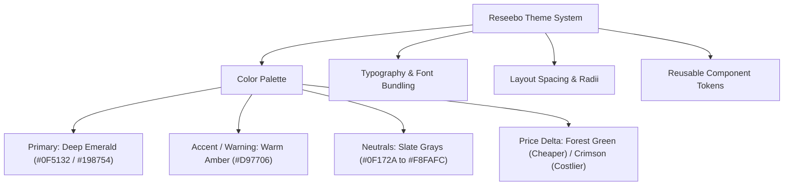
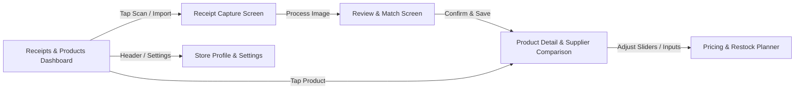

# Frontend Implementation Plan: Reseebo (Sari-Sari Store Receipt & Price Comparison App)

Receipt extraction improvements are tracked in [Receipt Autofill Improvement Plan](RECEIPT_AUTOFILL_PLAN.md).

> **Context & Baseline:** Reseebo is an offline-first Flutter application designed for Philippine sari-sari store owners to scan receipts via on-device OCR, track price histories across suppliers, and calculate suggested retail prices (SRP) and estimated profit (*tubo*).

---

## 1. Executive Summary & Architecture Strategy

### 1.1 Core Frontend Principles
1. **100% Offline from Cold Launch:** No remote dependencies, font CDN requests, or external telemetry. All fonts, icons, and assets are bundled locally.
2. **Clear Separation of Concerns:**
   - **UI Layers:** Screens (`screens/`) compose feature-specific widgets (`widgets/`) and shared core controls (`core/widgets/`).
   - **State Layer:** Decoupled state management (e.g., `ValueNotifier` / `ChangeNotifier` / `Riverpod` or `Bloc` / simple state controllers) isolated from widget rendering.
   - **Adapter Boundary:** UI interacts exclusively with typed Data Adapters (`core/adapters/`). The same interface serves both fixture mocks (Phase 1) and live local SQLite/ML Kit services (Phase 2+).
   - **Zero Business Logic in Widgets:** All unit conversions (packs to pieces), markup calculations, and difference deltas live in dedicated Dart models and calculation services.
3. **High Utility, Dense Yet Accessible UI (Filipino Retail UX):**
   - High legibility for peso amounts (`₱`), dates, and pack units.
   - Dual-indicator price changes: color + icons + explicit labels (e.g., `+₱0.40 (+5%)` with badge) so information is clear in direct sunlight or for color-blind users.
   - Non-blocking flows: store profile and markup setup are prompted gracefully when needed rather than locking the user out on first run.

---

## 2. Design System & Theming (`lib/core/theme/`)

Using guidance from `ui-ux-pro-max`, the design language balances utilitarian retail speed with a modern, trusted aesthetic:



### 2.1 Design Tokens
- **Primary Color:** Deep Emerald (`#0F5132`) – evokes trust, commerce, and Philippine currency.
- **Secondary / Accent:** Warm Amber (`#D97706`) – highlights warnings, markup alerts, and draft reviews.
- **Background & Surfaces:**
  - Light Background: Soft Warm Gray (`#F9FAFB`)
  - Card Surfaces: Clean White (`#FFFFFF`) with subtle border (`#E5E7EB`)
  - Dark/Dim contrast elements for receipt inspection overlay.
- **Status & Trend Colors:**
  - Price Decrease (Savings / Cheaper): Emerald (`#10B981`)
  - Price Increase (More Expensive): Crimson (`#EF4444`)
  - Unresolved / Ambiguous Match: Amber (`#F59E0B`)
- **Typography:**
  - Font Family: Bundled Google Font (e.g., `Inter` or `Plus Jakarta Sans`) stored in `assets/fonts/`.
  - Peso Display: Tabular numerical alignment for currency columns (`TextStyle(fontFeatures: [FontFeature.tabularFigures()])`).

---

## 3. Application Screen Breakdown & User Flows



### 3.1 Screen 1: Dashboard / Home (`features/dashboard/screens/dashboard_screen.dart`)
- **Key Elements:**
  - Header with Store Name, Store Photo/Avatar, and quick badge showing default markup (e.g., `Default Markup: 20%`).
  - Dual-Tab or Segmented View:
    1. **Recent Receipts:** Card list of saved receipts with supplier name, date, receipt thumbnail, line item count, and total amount.
    2. **Product Catalog:** List of tracked products with optional product photo thumbnail, brand/variant/size, latest recorded cost, and current selling price.
  - Floating Action Button (FAB): Prominent **"Scan Receipt"** button with camera icon.
  - Search / Filter Bar with debounced text input to quickly search products and suppliers without lagging SQLite.

### 3.2 Screen 2: Receipt Capture Screen (`features/receipt_scan/screens/capture_screen.dart`)
- **Key Elements:**
  - Options for Camera Capture or Gallery Import (via `image_picker`).
  - Viewfinder with receipt framing guides and lighting tips ("Lay flat, ensure good lighting").
  - Post-capture preview: Crop / rotate review before feeding into OCR parser.
  - Processing overlay with graceful progress feedback ("Reading receipt text offline...").

### 3.3 Screen 3: Review & Product Match Screen (`features/receipt_scan/screens/review_match_screen.dart`)
- **Crucial Interaction Area (Original Receipt vs. Parsed Draft):**
  - **Split / Collapsible View:** Interactive receipt image viewer (zoom/pan) pinned at the top or in a slide-out drawer so the owner can always verify against physical proof.
  - **Receipt Metadata Section:**
    - Supplier name (autocomplete against existing `Suppliers` table, plus "Add New Supplier").
    - Branch / Location field (important to distinguish branches of the same grocery).
    - Purchase Date picker (pre-filled with OCR extracted date, editable).
    - Optional Receipt Number and Notes.
  - **Parsed Line Items Editor:**
    - Extracted description (e.g., `BRANDX COF ORIG 26G`).
    - Matched Product Selector: Displays best suggested match based on `Product Aliases`.
    - Ambiguity Badge: Highlighted warning when confidence is low or multiple variants exist (e.g., 26g vs 33g).
    - Pack Conversion Controls:
      * Quantity (e.g., `2`)
      * Unit type: `Pack` vs `Pieces`
      * Pieces per pack (e.g., `10`)
    - Net Line Amount & Discount deduction.
    - Live Calculated Cost per piece preview (e.g., `₱8.40 / pc`).
  - **Action Guard:** Save button disabled while invalid numbers exist or when saving is in progress. Shows clear inline validation warnings.

### 3.4 Screen 4: Product Comparison & Price History (`features/comparison/screens/product_comparison_screen.dart`)
- **The Core Value Screen:**
  - **Product Summary Header:**
    - Product Photo (with camera tap to update/add local photo).
    - Brand, Variant, Size (e.g., *Brand X Original Coffee 26g*), Barcode, Category.
  - **Comparison Card 1: Latest Recorded Price Across Suppliers:**
    - Responsive mobile table:
      | Supplier | Last Bought | Pack Size | Cost/Pc | Diff vs Best |
      |---|---|---|---|---|
      | Puregold Branch A | 08 Oct 2026 | 2 pk × 10 | ₱8.40 | +₱0.60 |
      | Supermarket B | 05 Oct 2026 | 1 pk × 10 | ₱7.80 | **Lowest** |
      | Wholesaler C | 07 Oct 2026 | 1 pk × 10 | ₱8.10 | +₱0.30 |
    - Clear distinction between *Latest Recorded* and *All-Time Lowest Historical Price*.
  - **Comparison Card 2: Price History at Selected Supplier:**
    - Chronological table showing supplier price evolution:
      * Previous vs New purchase cost.
      * Amount change in Pesos and % (e.g., `+₱0.40 (+5%)`).
      * Direct link/button to view source receipt image.

### 3.5 Screen 5: Pricing & Restock Planning (`features/planner/widgets/restock_planner_card.dart`)
- **Restock Calculator:**
  - Input: Planned restock quantity in pieces (e.g., `100 pcs`).
  - Automatic pack calculation: Rounded up to a whole pack, ensuring the purchased piece count meets or exceeds the target (sari-sari owners cannot buy fractional packs).
  - Supplier comparison totals:
    * Total purchase cost at Supplier B vs Supplier A.
    * Gross purchase savings (e.g., `Save ₱60.00`).
  - Additional Cost Input: Travel / Tricycle fare / Delivery fee field (e.g., `+₱30.00`).
  - Net Estimated Savings: `₱60.00 - ₱30.00 = ₱30.00 net savings`.
- **Selling Price & Gross Profit (Tubo) Calculator:**
  - Markup Percentage: Uses product override markup if present (including 0%), otherwise store default markup.
  - Clearly displays:
    1. **Calculated Suggested Price:** e.g., `₱8.40 + 20% = ₱10.08` (or rounded suggestion `₱10.00`).
    2. **Owner-Set Selling Price:** Editable custom price (e.g., `₱10.00`).
    3. **Estimated Gross Profit:** `₱1.60 / pc (16.0% margin)`.

### 3.6 Screen 6: Store Profile & Catalog Editor (`features/profile/screens/profile_screen.dart`)
- Store Name and optional Owner Name.
- Store Photo / Logo picker.
- Default Markup Percentage setting with explanatory helper text.
- Catalog management: Manage custom product aliases, override markups, and delete/merge records.

---

## 4. Frontend Project Structure

```
reseebo_app/
├── assets/
│   ├── fonts/               # Bundled offline fonts (Inter / Plus Jakarta Sans)
│   ├── icons/               # Bundled SVG / vector icons
│   └── placeholders/        # Default receipt & product placeholder graphics
├── lib/
│   ├── core/
│   │   ├── adapters/        # IReseeboDataAdapter (Interface + Mock implementation)
│   │   ├── constants/       # App constants, formats (Date, Currency)
│   │   ├── errors/          # User-friendly UI error handling
│   │   ├── theme/           # AppTheme, AppColors, AppTypography, AppSpacing
│   │   └── widgets/         # AppButton, AppTextField, CurrencyText, TrendBadge, AppTable
│   ├── features/
│   │   ├── dashboard/
│   │   │   ├── screens/     # DashboardScreen
│   │   │   └── widgets/     # ReceiptListItem, ProductCatalogItem, StatHeader
│   │   ├── receipt_scan/
│   │   │   ├── screens/     # CaptureScreen, ReviewMatchScreen
│   │   │   └── widgets/     # ReceiptImageViewer, LineItemEditorRow, AliasMatchPicker
│   │   ├── comparison/
│   │   │   ├── screens/     # ProductComparisonScreen
│   │   │   └── widgets/     # SupplierComparisonTable, PriceHistoryTimeline
│   │   ├── planner/
│   │   │   └── widgets/     # RestockCalculatorCard, ProfitTuboCard
│   │   └── profile/
│   │       ├── screens/     # StoreProfileScreen
│   │       └── widgets/     # StoreLogoPicker, DefaultMarkupSlider
│   └── main.dart            # Offline entrypoint initializing theme & data adapter
└── test/
    ├── fixtures/            # Static JSON/Dart fixtures for 2 suppliers, repeat purchases
    └── widgets/             # Widget tests verifying table math, formatting, and states
```

---

## 5. Mock & Live Data Adapter Contract (`lib/core/adapters/`)

The frontend will depend strictly on `IReseeboDataAdapter`:

```dart
abstract class IReseeboDataAdapter {
  // Store Profile
  Future<StoreProfile> getStoreProfile();
  Future<void> updateStoreProfile(StoreProfile profile);

  // Products & Aliases
  Future<List<Product>> getProducts({String? query});
  Future<Product?> getProductById(String id);
  Future<void> saveProduct(Product product);
  Future<List<ProductMatchSuggestion>> matchAliases(String rawOcrDescription);

  // Receipts
  Future<List<Receipt>> getRecentReceipts({int limit = 20});
  Future<ReceiptDraft> processReceiptImage(String localImagePath);
  Future<SaveReceiptResult> saveConfirmedReceipt(ReceiptDraft confirmedDraft);

  // Comparisons & Pricing
  Future<ProductComparisonData> getProductComparison(String productId);
  Future<RestockEstimate> calculateRestock({
    required String productId,
    required int targetPieces,
    required double additionalCost,
  });
}
```

This guarantees:
1. Person B (Frontend) builds screens immediately with complete, realistic fixtures (Supplier A & B, repeated purchases, same-day purchases).
2. Person C (Local Services/Integration) can plug in the SQLite and OCR implementations without touching widget code.

---

## 6. Phased Execution Roadmap

### Phase 1: Foundation & Design System (Completed)
- [x] Initialize Flutter app skeleton in `reseebo_app/` with offline asset configuration in `pubspec.yaml`.
- [x] Build `lib/core/theme/` and configure centralized tokens (colors, typography, radii, ₱ formatting).
- [x] Build core shared widgets: `AppButton`, `AppCard`, `AppTextField`, `TrendBadge`, `CurrencyText`.
- [x] Create `MockReseeboDataAdapter` with realistic multi-supplier fixtures based on `SARI-SARI-RECEIPT-IDEA.md` (Brand X Original Coffee 26g across Puregold and Wholesaler).

### Phase 2: Screen Development with Mock Adapter (Completed)
- [x] **Dashboard:** Recent receipts list, products catalog tab, quick search.
- [x] **Receipt Capture & Review:**
  - Local image viewer with pinch-to-zoom.
  - Line item editor with pieces/pack selector and alias matching chips.
  - Validation guards and duplicate-save prevention.
- [x] **Product Comparison & Price History:**
  - Supplier comparison tables with highlighted lowest price.
  - Price change history rows with `+₱` and `%` badges.
- [x] **Pricing & Restock Planner:**
  - Interactive restock piece counter with whole pack rounding.
  - Tricycle/delivery fare input with instant net savings output.
  - Selling price & estimated tubo gross profit calculator.
- [x] **Store Profile Editor:** Store name, default markup setup, product photo update.
- [x] **Root Navigation & Tests:**
  - Root bottom navigation connecting Tindahan, Scan, and Settings.
  - Full unit test coverage for ceil rounding, profit margins, and formatting.
- [x] **UI/UX Pro Max Refactoring:**
  - Eliminated "AI-generated" tropes: stripped prompt-justifying checklists, decorative badge inflation, math equation glyphs (`×`, `=`, `÷`), and nested cards.
  - Aligned with high-density, sleek production standard (Linear / Apple Wallet / Stripe design style).

### Phase 3: Integration with Local SQLite & OCR Services (Hours 10–14)
- [x] Inspect implemented SQLite DAO and OCR service contracts from Backend/Integration owner.
- [x] Configure smart dual-mode adapter in `main.dart`: `SqliteReseeboDataAdapter` on-device with seamless web fallback.
- [x] Verify image file persistence via `path_provider` and atomic receipt saving across multiple pages.
- [x] Integrate on-device ML Kit OCR service, spatial line parser, and SQLite migrations (001, 002).
- [x] Unify domain models with dual currency accessors (cents for DB integrity, pesos for UI rendering).

### Phase 4: Polish, Edge Cases & Verification (Hours 15–18)
- [x] Verify 100% offline cold launch: removed internet permissions from AndroidManifest, bundled Inter font in assets.
- [x] Run `flutter analyze` across entire unified codebase (0 issues found, completely clean).
- [x] Run full test suite across storage DAO, pricing service, receipt parser, and UI widgets (65/65 tests passed).
- [x] Ensure small, atomic, chronological commits pushed to `feature/unified-fullstack`.
- [ ] Prepare demo walk-through recordings on device/browser.

---

## 7. Cloned Skills & Tooling Verification

From the reference repos in `the-pickle` and GitHub, the following have been established in this repository:
1. **Reference Repositories (`TeamCus/reference-repos/`):**
   - [agentic-awesome-skills](file:///c:/Users/Christopher/Documents/GitHub/TeamCus/reference-repos/agentic-awesome-skills) (25,000+ files, comprehensive agent skills library)
   - [better-icons](file:///c:/Users/Christopher/Documents/GitHub/TeamCus/reference-repos/better-icons) (Iconify CLI & MCP server)
   - [superdesign](file:///c:/Users/Christopher/Documents/GitHub/TeamCus/reference-repos/superdesign) (design system generation)
   - [ui-ux-pro-max-skill](file:///c:/Users/Christopher/Documents/GitHub/TeamCus/reference-repos/ui-ux-pro-max-skill) (multi-framework UI/UX intelligence)
   - [i-have-adhd](file:///c:/Users/Christopher/Documents/GitHub/TeamCus/reference-repos/i-have-adhd) (high-density concise agent workflow skill)
2. **Active Agent Skills (`TeamCus/.agents/skills/`):**
   - [ui-ux-pro-max](file:///c:/Users/Christopher/Documents/GitHub/TeamCus/.agents/skills/ui-ux-pro-max) (rules, style guides, Flutter design data)
   - [ui-styling](file:///c:/Users/Christopher/Documents/GitHub/TeamCus/.agents/skills/ui-styling)
   - [design-system](file:///c:/Users/Christopher/Documents/GitHub/TeamCus/.agents/skills/design-system)
   - [design](file:///c:/Users/Christopher/Documents/GitHub/TeamCus/.agents/skills/design)
   - [brand](file:///c:/Users/Christopher/Documents/GitHub/TeamCus/.agents/skills/brand)
   - [banner-design](file:///c:/Users/Christopher/Documents/GitHub/TeamCus/.agents/skills/banner-design)
   - [slides](file:///c:/Users/Christopher/Documents/GitHub/TeamCus/.agents/skills/slides)
   - [better-icons](file:///c:/Users/Christopher/Documents/GitHub/TeamCus/.agents/skills/better-icons)
   - [i-have-adhd](file:///c:/Users/Christopher/Documents/GitHub/TeamCus/.agents/skills/i-have-adhd)
3. **Repository Cleanliness:**
   - [`.gitignore`](file:///c:/Users/Christopher/Documents/GitHub/TeamCus/.gitignore) protects `.agents/` and `reference-repos/` from cluttering Git tracking.
